<div align="center">

  

  # 🚀 Awesome Migration Services

  <p align="center">
    <strong>A curated directory of top-tier Enterprise Migration SaaS Platforms, Cloud Rehosting Engines, Database Replication Frameworks &amp; Workload Cutover Automation.</strong>
  </p>

  <p align="center">
    <a href="https://github.com/ishandutta2007/Awesome-Awesome-Awesome"></a><a href="https://discord.gg/jc4xtF58Ve"></a>
    <a href="https://github.com/ishandutta2007/Awesome-Migration-Services/stargazers"></a>
    <a href="https://github.com/ishandutta2007/Awesome-Migration-Services/network/members"></a>
    <a href="https://github.com/ishandutta2007/Awesome-Migration-Services/blob/main/LICENSE"></a>
    <a href="https://github.com/ishandutta2007/Awesome-Migration-Services/pulls"></a>
    <a href="https://github.com/ishandutta2007"></a>
  </p>

</div>

---

## 📖 Overview & Architecture Landscape

In modern cloud computing and enterprise IT operations, **Migration Services** enable organizations to transition mission-critical workloads, databases, object storage buckets, SaaS tenant assets, and physical/virtual machines across heterogeneous hosting environments—from legacy on-premises data centers to hyperscale public clouds (AWS, Microsoft Azure, Google Cloud) and modern multi-cloud architectures.

Executing high-fidelity migrations with near-zero downtime requires automated orchestration across five essential technological layers:

1. **Discovery, Inventory & Dependency Mapping**: Automated agentless scanning engines that identify server dependencies, network topologies, performance utilization baselines, and database schemas to formulate precise Total Cost of Ownership (TCO) and right-sizing models upfront.
2. **Continuous Block-Level & Byte-Level Replication**: Asynchronous non-disruptive background replication agents that mirror OS disks and storage volumes without disrupting production source systems or locking transactions.
3. **Change Data Capture (CDC) & Data Streaming**: Real-time transaction log tailing that continuously streams incremental delta changes into target database engines until the planned cutover window.
4. **Automated Cutover Orchestration & Test-Cloning**: Isolated sandbox orchestration engines that perform full non-destructive test boots, network DNS updates, Active Directory/Entra ID identity preservation, and automated service redirection.
5. **SaaS Tenant & Workplace Consolidation**: Specialized high-throughput API ingestion tools capable of preserving security permissions, metadata, conversation threads, and version histories across Microsoft 365, Google Workspace, ServiceNow, and enterprise collaboration platforms.

---

## 📑 Table of Contents

- [🌐 Sector Overview & Market Dynamics](#-sector-overview--market-dynamics)
- [☁️ SaaS & Enterprise Migration Platforms](#️-saas--enterprise-migration-platforms)
- [🔓 Open-Source GitHub Projects (Ranked by Stars)](#-open-source-github-projects-ranked-by-stars)
- [📊 Architectural Comparison Matrix](#-architectural-comparison-matrix)
- [🤝 How to Contribute](#-how-to-contribute)
- [📈 Star History](#-star-history)
- [💖 Support & Sponsorship](#-support--sponsorship)
- [⚖️ Disclaimer](#️-disclaimer)

---

## 🌐 Sector Overview & Market Dynamics

The global **Cloud Migration Services Market** was valued at approximately **$45.2 Billion in 2024** and is projected to expand to **$224.7 Billion by 2033**, compounding at an aggressive **CAGR of ~23.8%**. This sustained acceleration is propelled by enterprise data center exit strategies, rapid modernization into cloud-native architectures, legacy database replatforming, and the critical imperative to feed high-performance data lakes for generative AI enterprise model pipelines.

The migration services ecosystem exhibits a **bifurcated, moderately fragmented structure**. At the foundational infrastructure layer, hyperscale cloud providers (AWS, Microsoft Azure, Google Cloud) maintain concentrated, winner-take-all dominance for target platform rehosting via proprietary ingestion engines. Conversely, at the application, SaaS tenant (Microsoft 365, Google Workspace, ServiceNow), and heterogeneous database/file tiers, the market is moderately fragmented across specialized independent software vendors (AvePoint, Quest, BitTitan, ShareGate) and self-hosted open-source tooling, preventing single-vendor monopolization.

---

## ☁️ SaaS & Enterprise Migration Platforms

The following table indexes prominent SaaS and hosted enterprise migration platforms, sorted in descending order of vendor scale (market capitalization / enterprise valuation):

| Platform / Vendor | Company Scale (Market Cap / Valuation) | Starting Tier Pricing | Free Tier Limit / Trial Terms | Workload Specialization & Key Capabilities |
| :--- | :--- | :--- | :--- | :--- |
| **[Azure Migrate](https://azure.microsoft.com/en-us/products/azure-migrate)** (Microsoft) | **$3.10 Trillion** Market Cap (~$245B Rev) | **$25.00 / month** per replicated server (after 180 days; assessments free) | **180 Days Free** continuous replication per server instance; unlimited assessments & discovery free forever | Unified discovery, business case TCO right-sizing, agentless server replication, and offline data transfer via Data Box to Microsoft Azure. |
| **[Migrate to Virtual Machines](https://cloud.google.com/migrate)** (Google Cloud) | **$2.15 Trillion** Market Cap (~$350B Rev) | **$0.00** tool license fee (billed solely for target GCP VMs; e.g. `e2` instances starting at ~$24.46/mo) | **Unlimited Free** software license forever + **$300 free credits for 90 days** on new GCP accounts | High-speed native VM replication from AWS, Azure, or on-prem VMware directly into Google Compute Engine with test-clone validation. |
| **[AWS Application Migration Service - MGN](https://aws.amazon.com/application-migration-service/)** (AWS) | **$2.05 Trillion** Market Cap (~$620B Rev) | **$0.042 / hour** per server (~$30.24/month per server after 90 days; underlying staging EC2/EBS apply) | **90 Days (2,160 hours) Free** continuous replication per source server for unlimited servers | Continuous block-level replication (succeeding CloudEndure) minimizing downtime for physical, virtual, or cloud servers into AWS. |
| **[ServiceNow Migration Services](https://www.servicenow.com/)** (ServiceNow) | **$190.0 Billion** Market Cap (~$11.0B Rev) | **$100.00** starting batch plan (via partner tools like Help Desk Migration for up to 1,000 records) | **Free Demo Migration** (up to 20 tickets/records with live field mapping test and relationship verification) | Enterprise ITSM re-platforming from legacy tools (Jira, Zendesk, BMC) to ServiceNow with schema mapping and custom field preservation. |
| **[Carbonite Migrate](https://www.carbonite.com/)** (OpenText) | **$8.5 Billion** Market Cap (~$5.8B Rev) | **$500.00** per server license (Standard edition node-locked with 60-day active replication window) | **30-Day Evaluation Key** per server node (full byte-level replication and automated cutover drill before commit) | Real-time byte-level asynchronous continuous replication across any physical, virtual, or cloud environment with AES-256 encryption. |
| **[Quest On Demand Migration](https://www.quest.com/)** (Quest Software) | **$5.4 Billion** Valuation (~$1.3B Rev) | **$12.00 / user** (entry volume tier for tenant-to-tenant migration modules via partner catalog) | **30-Day Free Trial** (capped at 5 user accounts / mailboxes up to 5 GB each, 256 MB OneDrive, 5 SharePoint sites) | Enterprise Microsoft 365 and Entra ID tenant consolidation, Exchange mailboxes, Teams channels/chats, and domain coexistence. |
| **[AvePoint Fly](https://www.avepoint.com/)** (AvePoint) | **$2.8 Billion** Market Cap (~$330M Rev) | **$8.00 / user** annually (~$0.67/user/month for standard tenant packages via CSP partners) | **30-Day Free Trial** for pilot migrations; discovery & tenant inventory scanning is **Free Forever** | Enterprise content migration covering Microsoft 365, Google Workspace, Slack, Box, Dropbox, and file shares with STIG compliance. |
| **[ShareGate Migrate](https://sharegate.com/)** (Workleap) | **$2.5 Billion** Valuation (~$150M Rev) | **$5,995.00 / year** (~$499.58/month) flat rate for 1 concurrent seat with unlimited data & users | **15-Day Free Trial** with full feature set (randomly skips select files/items to prevent production cutover) | SharePoint, Microsoft Teams, OneDrive, and Google Drive migration with pre-check validation and zero per-gigabyte transfer fees. |
| **[BitTitan MigrationWiz](https://www.bittitan.com/)** (Idera) | **$1.2 Billion** Valuation (~$100M Rev) | **$14.00 / user** (Mailbox Migration license up to 50 GB data limit; $17.50 for full user bundle) | **Free Account Trial Pass** (up to 10 items per folder or max 5 MB per mailbox, no credit card required) | Turnkey SaaS cloud migration for mailboxes, personal archives, OneDrive documents, and Teams with automated Outlook reconfiguration. |

---

## 🔓 Open-Source GitHub Projects (Ranked by Stars)

A curated list of leading self-hosted and open-source migration tools, streaming replication frameworks, and object storage utilities, strictly sorted in descending order of GitHub stargazers:

- **[Rclone](https://github.com/rclone/rclone)** [](https://github.com/rclone/rclone/stargazers) — The Swiss army knife of cloud storage data synchronization and cross-cloud migration. Supports 70+ cloud providers (S3, Google Cloud Storage, Azure Blob, OneDrive, Dropbox, SFTP) with multi-threaded transfers, bandwidth limiters, checksum verification, and transparent encryption.
- **[Airbyte](https://github.com/airbytehq/airbyte)** [](https://github.com/airbytehq/airbyte/stargazers) — Leading open-source ELT data integration engine. Features 350+ pre-built connectors to migrate database tables, event feeds, and records between relational databases (PostgreSQL, MySQL, Oracle) and cloud warehouses (Snowflake, BigQuery, Databricks) with automated schema discovery.
- **[golang-migrate](https://github.com/golang-migrate/migrate)** [](https://github.com/golang-migrate/migrate/stargazers) — High-performance database migration CLI and Go library supporting 25+ database engines (PostgreSQL, MySQL, SQLite, Redshift, ClickHouse, Spanner, CockroachDB). Reads migration files from disk, GitHub, or S3 with atomic version tracking and automatic rollbacks.
- **[Litestream](https://github.com/benbjohnson/litestream)** [](https://github.com/benbjohnson/litestream/stargazers) — Streaming replication tool for SQLite databases running in the background. Continuously replicates WAL frames to S3-compatible object storage or SFTP, enabling point-in-time recovery and zero-downtime server migrations for SQLite applications.
- **[Debezium](https://github.com/debezium/debezium)** [](https://github.com/debezium/debezium/stargazers) — Distributed Change Data Capture (CDC) platform built on Apache Kafka. Ingests row-level change streams from PostgreSQL, MySQL, SQL Server, Oracle, and MongoDB to execute zero-downtime database migrations with continuous sync during transition windows.
- **[Velero](https://github.com/vmware-tanzu/velero)** [](https://github.com/vmware-tanzu/velero/stargazers) — Cloud-native Kubernetes disaster recovery, cluster migration, and persistent volume backup tool. Allows seamless migration of entire Kubernetes application manifests and Persistent Volumes across cloud providers and on-prem clusters.
- **[Flyway](https://github.com/flyway/flyway)** [](https://github.com/flyway/flyway/stargazers) — Industry-standard open-source database migration and version control tool supporting 20+ relational DBMS. Executes schema DDL/DML scripts via clean SQL or Java code with automated checksum verification and migration history auditing.
- **[pgloader](https://github.com/dimitri/pgloader)** [](https://github.com/dimitri/pgloader/stargazers) — High-throughput database migration tool designed specifically to migrate data from MySQL, SQLite, MS SQL, or CSV files into PostgreSQL with automated type casting, schema conversion, and parallel data streaming.
- **[CloudQuery](https://github.com/cloudquery/cloudquery)** [](https://github.com/cloudquery/cloudquery/stargazers) — High-performance open-source ELT framework that extracts cloud infrastructure assets, configurations, and IAM policies from AWS, Azure, GCP, and Kubernetes into analytical databases for migration inventory planning.
- **[Chorus](https://github.com/clyso/chorus)** [](https://github.com/clyso/chorus/stargazers) — Distributed, vendor-neutral S3-compatible object storage replication, routing, and migration proxy (written in Go). Supports live background bucket synchronization, diff verification, and zero-downtime cutover between cloud and self-hosted storage providers.
- **[imap-migration-tools](https://github.com/JCallico/imap-migration-tools)** [](https://github.com/JCallico/imap-migration-tools/stargazers) — Python toolkit providing CLI, full-screen TUI, and native GUI interfaces for migrating email mailboxes between IMAP providers (including Gmail, Outlook, Exchange, and custom IMAP servers) with OAuth2 authentication.

---

## 📊 Architectural Comparison Matrix

| Architectural Capability | Cloud Rehosting (AWS MGN / Azure Migrate) | Database CDC (Debezium / pgloader) | Tenant Migration (BitTitan / Quest / AvePoint) | Object Sync (Rclone / Chorus) |
| :--- | :--- | :--- | :--- | :--- |
| **Primary Workload** | Physical, Virtual, and Cloud OS Disks | Relational & Document Database Schemas/Rows | Mailboxes, Teams, SharePoint, OneDrive | S3 Buckets, Blob Containers, SFTP |
| **Replication Level** | Block-level / Sector-level Disk I/O | Row-level Change Data Capture (CDC) | Application Object / Graph API Entities | Object-level & Metadata Streaming |
| **Downtime Impact** | Near-zero (seconds for final DNS cutover) | Near-zero (continuous log sync) | Zero impact during incremental sync | Zero downtime (continuous replication) |
| **Cutover Testing** | Non-destructive sandbox test clones | Dual-write validation & row count verification | Delta passes & pre-flight staging verification | Checksum hashing & head-object comparisons |
| **Best-Fit Scenario** | Full data center exits & lift-and-shift | Database modernization & cross-engine shifts | M&A consolidation & tenant re-platforming | Multi-cloud storage backup & provider changes |

---

## 🤝 How to Contribute

Contributions, tool suggestions, and documentation enhancements are highly encouraged!

1. **Fork the repository** to your personal GitHub account.
2. **Create a descriptive feature branch**:
   ```bash
   git checkout -b feat/add-migration-tool
   ```
3. **Commit your modifications** ensuring clear, factual data, exact pricing/trial terms, official links, and clean Markdown table formatting.
4. **Push the branch** and **open a Pull Request** with an informative summary of your changes.

---

## 📈 Star History

[](https://star-history.dera.page/#ishandutta2007/Awesome-Migration-Services&type=date&legend=top-left)

---

## 💖 Support & Sponsorship

If you find this curated migration services directory useful for your infrastructure planning, cloud migrations, or DevOps workflows:

- ⭐ **Star this repository** on GitHub to amplify its reach!
- 🍴 **Fork the repo** to preserve your personal reference copy.
- 📢 **Share with fellow engineers**, sysadmins, cloud architects, and IT leaders.
- ☕ **Support continuous maintenance & research** by sponsoring via the link below:

<p align="center">
  <a href="https://github.com/sponsors/ishandutta2007">
    
  </a>
</p>

---

## ⚖️ Disclaimer

- This repository is a **community-curated index** created solely for informational, architectural, and educational purposes. Mention of specific vendors, open-source projects, or commercial SaaS products does not constitute an official endorsement.
- Pricing, packaging, and free trial terms are subject to change by respective vendors. Consult official vendor websites for real-time contractual quotes and Service Level Agreements.
- Migration services handling production data and access credentials must comply with strict data protection regulations (GDPR, HIPAA, SOC 2); implement credential rotation, encryption in-transit and at-rest, and thorough audit logging before executing production cutovers.
- Verify software license terms (Apache-2.0, MIT, AGPL-3.0) prior to commercial redistribution or proprietary internal modifications.

---

<p align="center">
  <strong>Crafted with ❤️ for cloud architects, systems administrators, DevOps engineers, and IT leaders shaping seamless enterprise migrations.</strong>
</p>
